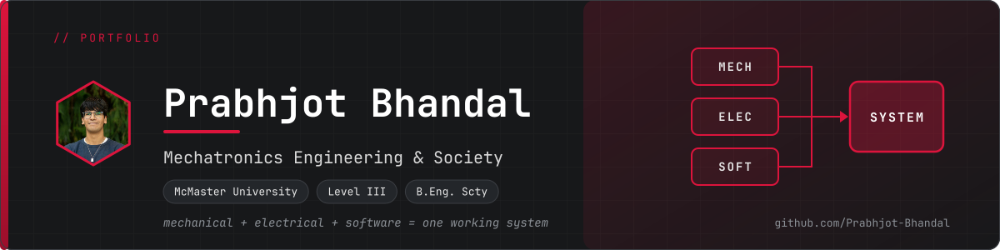
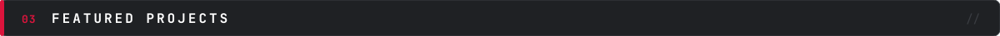

<!--
  README.md: GitHub profile README (lives in the repo named exactly like your username).

  Layout, top to bottom:
    1. Banner + status badge
    2. about-skills.svg           (About with quick facts, then Skills)   <- image
    3. sec-projects.svg + table   (Featured Projects: real HTML so the links are clickable)
    4. how-leadership-beyond.svg  (How I Work, Leadership & Teaching, Beyond the Code)   <- image
    5. Footer bar + contact line

  The text inside the images lives in tools/gen_assets.py. Edit it there, run  py tools\gen_assets.py,
  then upload the new SVGs. After you change image text, update the matching alt="" text below so
  screen readers get the same words.
  Anything in [square brackets] is a placeholder: replace it with a real fact, or delete it.
  HTML comments like this one are hidden on GitHub.
-->

<!-- HERO: banner image and a crimson "seeking co-op" status badge (shields.io). Update the dates in the badge URL as needed. -->

 

 

<!--
  ABOUT + SKILLS: two cards stacked in one image (assets/about-skills.svg).
  About = description on the left, quick-facts panel on the right. Skills = pills grouped by category.
-->

 

<!--
  FEATURED PROJECTS: stays as HTML (not an image) so every project title is a clickable link.
  Six cards in a 3x2 grid. Each card has a linked title, your role, tech tags (inline code),
  a one-line description, and a result placeholder.
  The repo links assume the repo names from your guide; remove any card whose repo does not exist yet.
  Reorder the cards before each application so the most relevant projects come first.
-->

 

<table>
<tr>
<td valign="top" width="33%">

**[Aerial Robotics Electrical Integration](https://github.com/Prabhjot-Bhandal/aerial-robotics-electrical-integration)** 
ELECTRICAL TEAM LEAD

`Altium` `Integration` `Bring-up`

Electrical subsystems integrated with software and mechanical, validated before flight tests. 
**Result:** [one-line result]

</td>
<td valign="top" width="33%">

**[Habit Tracker Tamagotchi](https://github.com/Prabhjot-Bhandal/habit-tracker-tamagotchi)** 
DESIGNER / BUILDER

`Firmware` `FDM enclosure` `User testing`

A habit-tracking pet built end to end: requirements, hardware, firmware, enclosure, and user tests. 
**Result:** [one-line result]

</td>
<td valign="top" width="33%">

**[Designathon: Modular Snow Travel Multitool](https://github.com/Prabhjot-Bhandal/designathon-snow-travel-multitool)** 
PROJECT COORDINATOR

`Inventor` `Coordination` `24-hour build`

A 24-hour design sprint, coordinated from constraints to final presentation. 
**Result:** [one-line result]

</td>
</tr>
<tr>
<td valign="top" width="33%">

**[Team Ops Toolkit](https://github.com/Prabhjot-Bhandal/team-ops-toolkit)** 
AUTHOR

`Action logs` `Risk register` `RACI`

Templates for running engineering teams, filled with sample data. 
**Result:** [one-line result]

</td>
<td valign="top" width="33%">

**[Teaching & Training Portfolio](https://github.com/Prabhjot-Bhandal/teaching-and-training-portfolio)** 
INSTRUCTOR

`Workshops` `Onboarding` `Lesson plans`

Workshops and onboarding plans I designed, taught, and revised after feedback. 
**Result:** [one-line result]

</td>
<td valign="top" width="33%">

**[Clean-Up Crab](https://github.com/Prabhjot-Bhandal/clean-up-crab-robot)** 
SOLO DESIGNER

`Arduino` `Ultrasonic` `Servo`

A sensor-and-actuator robot built over several iterations, with an honest write-up of what broke. 
**Result:** [one-line result]

</td>
</tr>
</table>

Also: [Custom Game Launcher](https://github.com/Prabhjot-Bhandal/custom-game-launcher) (Java) and a Windows 10 game port with 1,000+ downloads.

 

<!--
  HOW I WORK + LEADERSHIP & TEACHING + BEYOND THE CODE: three cards stacked in one image
  (assets/how-leadership-beyond.svg). Edit the wording in tools/gen_assets.py (CARD_HOW, CARD_LEADERSHIP,
  CARD_BEYOND). The script prints a WARNING until the [bracketed placeholders] are replaced.
  After you fill them in, update the alt text below to match.
-->

Templates and examples behind these practices are in the <a href="https://github.com/Prabhjot-Bhandal/team-ops-toolkit">Team Ops Toolkit</a>.

 

<!-- FOOTER: closing bar (Break. Build. Adapt.), then the contact line. Email only (no phone number or address). Fill in the LinkedIn and resume links. -->

 

`bhandp9@mcmaster.ca` &nbsp;·&nbsp; [LinkedIn](https://www.linkedin.com/in/[your-handle]) &nbsp;·&nbsp; [Resume (PDF)](https://[link-to-resume])

