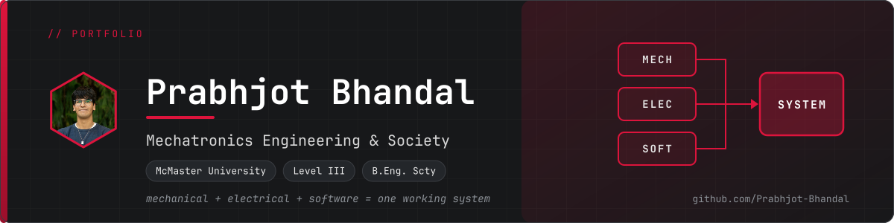
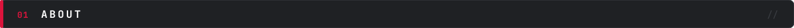
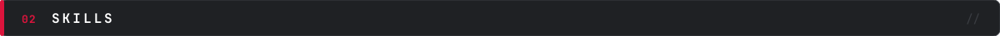
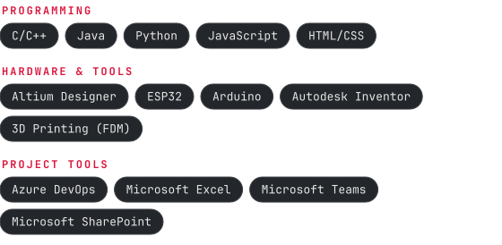
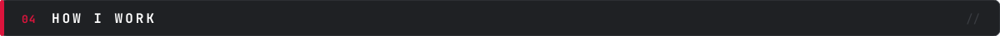
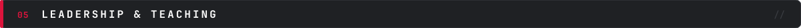
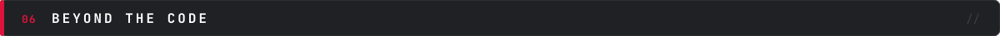
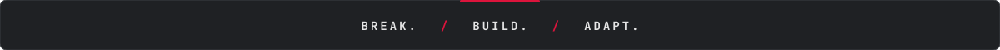

<!--
  README.md: GitHub profile README (lives in the repo named exactly like your username).
  Layout, top to bottom: banner, status badge, About, Skills, Featured Projects,
  How I Work, Leadership & Teaching, Beyond the Code, footer, contact line.
  Anything in [square brackets] is a placeholder: replace it with a real fact, or delete it.
  Headers, skill pills, and the banner are SVG images in /assets (made by gen_assets.py).
  HTML comments like this one are hidden on GitHub.
-->

<!-- HERO: banner image and a crimson "seeking co-op" status badge (shields.io). Update the dates in the badge URL as needed. -->

 

 

<!-- ABOUT: your story on the left, a quick-facts panel on the right (two-column HTML table). -->

<table>
<tr>
<td valign="top" width="62%">

 

I started engineering by taking things apart (including, once, my family's TV) and refusing to stop until I had put them back together. Student projects taught me to question a design before building it. Now I lead an electrical team and want to teach others to do the same.

I make mechanical, electrical, and software subsystems work together as one system, keep multidisciplinary teams organized enough to deliver it, and help others learn to build.

</td>
<td valign="top" width="38%">

 

<code>School</code>&nbsp; McMaster University 
<code>Program</code>&nbsp; Mechatronics Eng. & Society 
<code>Year</code>&nbsp; 3rd year · B.Eng. 2029 
<code>Looking for</code>&nbsp; Co-op, May / Sept 2027 
<code>Focus</code>&nbsp; Integration · Organization · Teaching

</td>
</tr>
</table>

 

<!-- SKILLS: pill image (skills.svg) for languages and tools, plus a text line for protocols and lab equipment. Only list what you can be quizzed on. -->

 

**Protocols:** [only protocols you have actually used] &nbsp;·&nbsp; **Lab equipment:** [only equipment you have used, e.g. oscilloscope, DMM]

 

<!--
  FEATURED PROJECTS: six cards in a 3x2 grid. Each card has a linked title, your role,
  tech tags (inline code), a one-line description, and a result placeholder.
  The repo links assume the repo names from your guide; remove any card whose repo does not exist yet.
  Reorder the cards before each application so the most relevant projects come first.
-->

 

<table>
<tr>
<td valign="top" width="33%">

**[Aerial Robotics Electrical Integration](https://github.com/Prabhjot-Bhandal/aerial-robotics-electrical-integration)** 
ELECTRICAL TEAM LEAD

`Altium` `Integration` `Bring-up`

Electrical subsystems integrated with software and mechanical, validated before flight tests. 
**Result:** [one-line result]

</td>
<td valign="top" width="33%">

**[Habit Tracker Tamagotchi](https://github.com/Prabhjot-Bhandal/habit-tracker-tamagotchi)** 
DESIGNER / BUILDER

`Firmware` `FDM enclosure` `User testing`

A habit-tracking pet built end to end: requirements, hardware, firmware, enclosure, and user tests. 
**Result:** [one-line result]

</td>
<td valign="top" width="33%">

**[Designathon: Modular Snow Travel Multitool](https://github.com/Prabhjot-Bhandal/designathon-snow-travel-multitool)** 
PROJECT COORDINATOR

`Inventor` `Coordination` `24-hour build`

A 24-hour design sprint, coordinated from constraints to final presentation. 
**Result:** [one-line result]

</td>
</tr>
<tr>
<td valign="top" width="33%">

**[Team Ops Toolkit](https://github.com/Prabhjot-Bhandal/team-ops-toolkit)** 
AUTHOR

`Action logs` `Risk register` `RACI`

Templates for running engineering teams, filled with sample data. 
**Result:** [one-line result]

</td>
<td valign="top" width="33%">

**[Teaching & Training Portfolio](https://github.com/Prabhjot-Bhandal/teaching-and-training-portfolio)** 
INSTRUCTOR

`Workshops` `Onboarding` `Lesson plans`

Workshops and onboarding plans I designed, taught, and revised after feedback. 
**Result:** [one-line result]

</td>
<td valign="top" width="33%">

**[Clean-Up Crab](https://github.com/Prabhjot-Bhandal/clean-up-crab-robot)** 
SOLO DESIGNER

`Arduino` `Ultrasonic` `Servo`

A sensor-and-actuator robot built over several iterations, with an honest write-up of what broke. 
**Result:** [one-line result]

</td>
</tr>
</table>

Also: [Custom Game Launcher](https://github.com/Prabhjot-Bhandal/custom-game-launcher) (Java) and a Windows 10 game port with 1,000+ downloads.

 

<!--
  HOW I WORK: your three pillars (Integration, Organization, Teaching) in three columns,
  a link to the Team Ops Toolkit as proof, and the "mistake then / practice now" table.
  Fill the brackets with measured facts only. Never invent a number.
-->

 

<table>
<tr>
<td valign="top" width="33%">

**Integration**

[One sentence with a concrete example, e.g. "I integrate power, sensing, and firmware on a drone team so subsystems pass bring-up tests before flight."]

</td>
<td valign="top" width="33%">

**Organization**

[One sentence with a real number, e.g. "I run a weekly sync for [N] people across 3 subteams and track [N] dependencies in a shared backlog."]

</td>
<td valign="top" width="33%">

**Teaching**

I co-led a summer camp for 150+ students in Grades 6 to 10 and designed a cryptography escape-room workshop. [Confirm dates; add one number.]

</td>
</tr>
</table>

I publish the work behind the claims, so you can check it instead of taking my word for it: interface tables, bring-up logs, action logs, and risk registers. Templates are in the [Team Ops Toolkit](https://github.com/Prabhjot-Bhandal/team-ops-toolkit).

Mistakes from an early student project became standing habits on my team:

| Mistake then | Practice I use now |
|:--|:--|
| Did not question the design enough | Design review before any build |
| No error log | Shared error and decision log |
| Late print planning | Schedule long-lead items in week one |

 

<!-- LEADERSHIP & TEACHING: one line per role, with the title in code style. Add real dates where marked [confirm dates]. -->

 

- `Electrical Team Lead` &nbsp;McMaster Aerial Robotics & Drone Team
- `MES & External Liaison` &nbsp;McMaster Engineers with Disabilities
- `Project Coordinator` &nbsp;McMaster Design League Designathon 2026
- `Student Tutor` &nbsp;Peel District School Board Coding Camp [confirm dates]
- `Founder` &nbsp;The ArrowHack, a high-school hackathon with 60+ competitors

 

<!-- BEYOND THE CODE: your personality. Keep it to 2 or 3 lines. -->

 

[1 to 2 real lines: cities, local history, overanalyzing media.]

 

<!-- FOOTER: closing bar with the three pillars, then the contact line. Email only (no phone number or address). Fill in the LinkedIn and resume links. -->

 

`bhandp9@mcmaster.ca` &nbsp;·&nbsp; [LinkedIn](https://www.linkedin.com/in/[your-handle]) &nbsp;·&nbsp; [Resume (PDF)](https://[link-to-resume])

